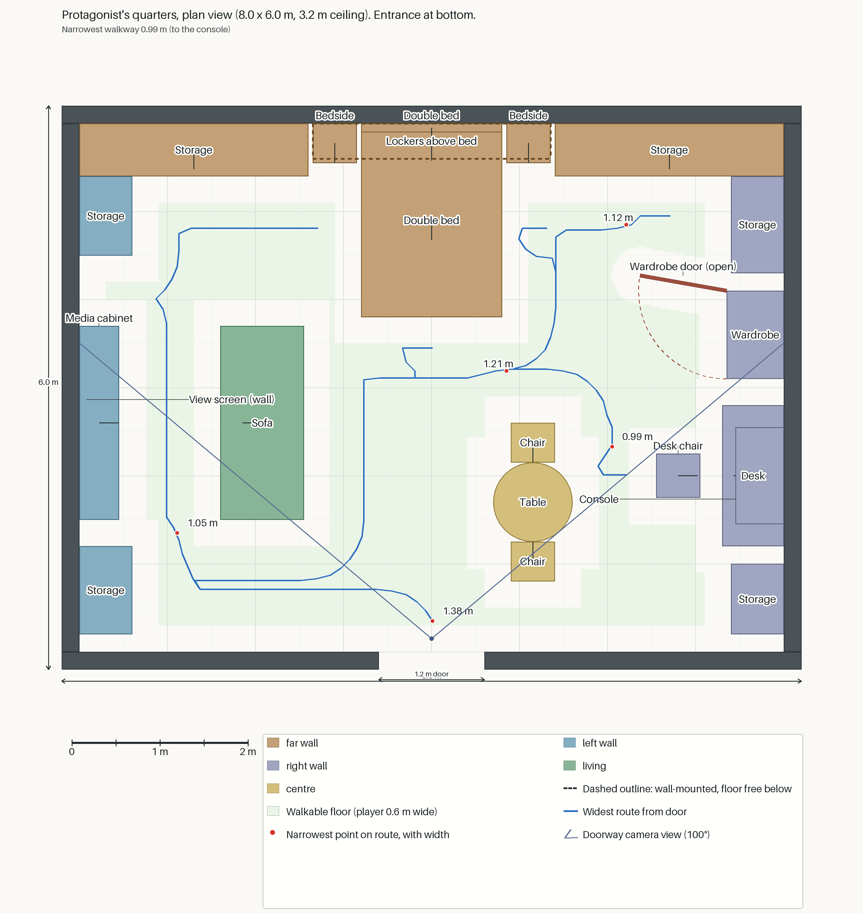

# Quarters art

The protagonist's quarters are on D16, starboard of section 42. The room contains the couple's furniture, clothes and small belongings. Entering shows Remembered; using the desk console plays a placeholder message and changes the room to Present. The transition persists for the current session.

## Playable demo

From the repository root:

```sh
godot --path . -- --start quarters
```

The player starts facing the quarters door with secondary power active. Space operates the manual release. The framed pull handle beside the door is also selectable and carries a Naleya label that resolves into Spanish. Walk inside and use the console on the right. Its corruption, message and fault phases last 60, 180 and 60 logical ticks. Normal startup still begins in stasis; the aft ladder well and `D16-C-001-H-AFT` provide the route to this room.

Remembered has warm ceiling lighting and working bedside lamps. Present uses secondary-power white strips with the bedside lamps off. The console remains lit in both states. The wall view screen is off in both states.

### Two finish states

Remembered means as issued. Present depicts about 1000 years of dry, sealed, sterile, oxygenated storage: settled dust, faded cloth, collapsed foam and dry brown oxide. There is no green corrosion, wet grime, mould or biological rot. Original green paint may remain on steel. The tunic medal uses brown-aged brass and separately aged blue enamel.

Both states share placements and collision. Rigid furniture generally swaps materials; soft goods and clothes have separate deformed exports. Changing an aged asset must preserve its placement origin and the supports it shares with the remembered asset.

## Layout and runtime ownership

[layout.json](layout.json) defines the 8 by 6 m room, its 3.2 m clear height, footprints, use points and doorway camera. `sim/quarters_layout.gd` maps room-local `(x, y, z)` to ship coordinates `(49 - x, -11 + y, 1.7 + z)`. The interior spans ship X 41..49, Y -11..-7.8 and Z 1.7..7.7. The corridor owns the pierced entrance wall.

`sim/quarters_inventory.gd` supplies placements to both state roots and the shared collider list. `app/quarters_room.gd` builds the room; `app/quarters_furnishings.gd`, `app/quarters_clothing.gd` and `app/quarters_small_items.gd` install its contents. `sim/quarters_memory.gd` owns the transition. Storage drawer/shelf modules and leftover storage infill remain stand-ins, named with the `Standin_storage_` prefix.



Rebuild the plan with a Python environment containing Pillow, NumPy and SciPy:

```sh
python tools/art/quarters_plan.py --layout docs/art/quarters/layout.json --out docs/art/quarters/plan.png --report docs/art/quarters/plan-checks.json
```

The plan tool checks room bounds, floor-footprint intersections, player reach, route clearance and doorway access. The [production workflow](PLAN.md) explains how to change assets without changing the room frame.

## Tools and export conventions

Run commands below from the repository root. `python` means an environment with the dependencies imported by the selected tool, including NumPy, Pillow, SciPy and trimesh for the asset checks. The existing local art environment is `/Volumes/XS1000/acoliver/projects/3dlocal/hunyuan3d/.venv/bin/python`.

Set `BLENDER` to Blender 4.5.11 LTS. On the art workstation it is `/Volumes/XS1000/acoliver/projects/threedee/branch-1/.tools/Blender-4.5.11.app/Contents/MacOS/Blender`. Use a writable output directory outside the tracked source tree for repeat exports:

```sh
OUT="$PWD/art-output"
mkdir -p "$OUT"
```

Quarters assets are authored with Blender +Z up and front -Y. Exporters use `export_yup=True`, producing glTF +Y up and front +Z. Verify the exported bounds outside Blender. Saved-source export is the supported way to reproduce a shipped mesh without rerunning generation or cloth simulation.

After replacing GLBs or textures, refresh native Godot imports before viewing them:

```sh
godot --headless --editor --path . --import
```

A source file's presence alone does not establish what Godot renders. For the tunic, the native-import checker in the [medal guide](sheets/medal/README.md#verification) checks the imported source as well.

## Contact sheets

The tracked concepts are [Remembered](concept-remembered.png), [Present](concept-now.png) and their [paired sheet](concept-pair.png). Generated hero images and selected views live under `sheets/`; prompts live under `prompts/`. The [furniture heroes](sheets/batch1-heroes.png) provide a compact inventory reference.

`tools/art/contact_sheet.py` provides `hero`, `views` and `sheet` subcommands. For example, inspect the locker generation command without invoking an image model:

```sh
python tools/art/contact_sheet.py hero --prompts docs/art/quarters/prompts/pilot.json --prop storage_locker_module --out "$OUT/contact" --dry-run
```

The hero is the primary Hunyuan input. Additional generated views are useful only when they depict the same object at the requested angle. Side and back views often change the design or repeat the front. Retain the selected image and generated mesh as fitting references.

## Storage locker module

Wall storage uses `assets/props/quarters/storage_locker_module.glb`. Its editable source is `tools/blender/quarters/storage_locker_module/locker-working.blend`. The 0.6 by 2.4 by 0.6 m carcass has a recessed kick plate, a pivoted door, louvres, hinges and a recessed handle. Complete modules tile the approved storage footprints; remaining width uses infill.

Export the saved source and inspect its exported geometry:

```sh
"$BLENDER" --background --factory-startup --python-exit-code 1 --python tools/blender/quarters/storage_locker_module/build.py -- --output "$OUT/storage_locker_module.glb"
python tools/blender/quarters/storage_locker_module/trimesh_verify.py "$OUT/storage_locker_module.glb"
```

The Blender-hosted `verify.py` in the same directory takes `--input` and `--report` after the separator. It checks the door, hardware, closure and repeat export. `trimesh_verify.py` checks the game-space axes and bounds.

### Locker materials

`art-source/quarters/locker/faces/` contains complete generated face images, source crops, prompts and the selected-image map. These images supply paint loss, oxide and dust placement. `tools/quarters_aging/select_locker_faces.py` selects saved candidates; `finish_locker_faces.py` packs the finish. Neither requires another image-generation run. The runtime atlases are under `assets/props/quarters/storage_locker_module/`; `app/quarters_props.gd` selects the cached state material.

```sh
python tools/quarters_aging/select_locker_faces.py
python tools/quarters_aging/finish_locker_faces.py
python -m unittest discover -s tools/quarters_aging -p 'test_*.py'
```

`tools/blender/quarters/storage_locker_module/hinge_finish.py` rebuilds the smooth hinge finish separately. Run it through Blender only when changing that hardware.

Known limitations: connected door flaking can look dense, top dust can look cloudy at sheet scale, and hardware bands remain visible in some views. Fine-feature judgments on narrow face strips are limited by their image size.

## Sofa

The sofa faces the wall screen. `sofa.glb` and `sofa_aged.glb` under `assets/props/quarters/` contain the clean and collapsed states. Current editable export sources are `sofa-material-clean.blend` and `sofa-material-aged.blend` under `tools/blender/quarters/sofa/`. Cushions and the throw are baked cloth meshes. The source images, charcoal upholstery, oatmeal throw and dust calibration are under `art-source/quarters/sofa/`.

```sh
"$BLENDER" --background --factory-startup --python-exit-code 1 --python tools/blender/quarters/sofa/material_pilot.py -- --stage export --state as_built --output "$OUT/sofa.glb"
"$BLENDER" --background --factory-startup --python-exit-code 1 --python tools/blender/quarters/sofa/material_pilot.py -- --stage export --state aged --output "$OUT/sofa_aged.glb"
cmp assets/props/quarters/sofa.glb "$OUT/sofa.glb"
cmp assets/props/quarters/sofa_aged.glb "$OUT/sofa_aged.glb"
```

`app/quarters_props.gd` keeps separate cached solid and transparent powder materials. `tests/quarters_props_test.gd` covers routing and resource sharing. Material and geometry checks also live under `tools/quarters_aging/` and `tools/blender/quarters/sofa/`.

Known limitations: aged back cushions retain sharp adjacency, some tears have straight or even-width contours, and damaged edges do not consistently read as fabric. Geometry work is stopped at the owner's chosen shape. Rebuilding the aged material preparation from its original intermediate requires a local checkpoint; use the committed material sources for export.

## Tunic

The uniform hangs inside the open wardrobe. `tools/blender/quarters/dress_uniform/tunic-working.blend` and `tunic-pilot.blend` are the current mounted clean and aged sources. They export `dress_uniform.glb` and `dress_uniform_aged.glb`. The garment uses sewn cloth patterns, separate collar details, eight buttons, a woven ribbon and a generated-surface brass/enamel medal. Packed textures stay with the sources; cloth and detail textures are also retained beside the tools.

Use the [medal guide](sheets/medal/README.md) for both saved-source export commands, detail tests and current medal source files. `tests/quarters_clothes_test.gd` and `tests/quarters_reflected_clothes_test.gd` cover room integration. The wardrobe places the hook on its 1.82 m rail and seats aged debris on its raised bottom panel.

Known limitations: broad torso shading and weak visible wool microtexture remain. Some cloth tear and contour targets remain unmet. The full cloth reconstruction needs an original sleeve intermediate that is absent from the tracked tree. Saved-source exports avoid that dependency.

## Rigid furniture

The bed frame, desk, console, desk chair, dining table, dining chair, bedside units, wall screen, media cabinet, over-bed lockers and wardrobe are real fitted assets. The dining chair and bedside unit are each instanced twice. For each asset id below, the source is `tools/blender/quarters/<id>/<id>-working.blend`, the exporter is that directory's `build.py`, and the output is `assets/props/quarters/<id>.glb`.

| Asset id | Use |
| --- | --- |
| `bed` | Frame, platform and separate headboard |
| `desk` | Console worktop and storage |
| `console` | Message display; separate keyboard described in [console-129.md](console-129.md) |
| `desk_chair` | Desk seating |
| `dining_table`, `dining_chair` | Table and two chairs |
| `bedside` | Two cabinets with lamps |
| `view_screen` | Inactive wall display |
| `media_cabinet` | Storage below the wall display |
| `lockers_over_bed` | Wall-mounted storage |
| `wardrobe` | Open carcass, rail and door parked at 100 degrees |

For example, export and verify the wardrobe from its retained source:

```sh
"$BLENDER" --background --factory-startup --python-exit-code 1 --python tools/blender/quarters/wardrobe/build.py -- --output "$OUT/wardrobe.glb"
python tools/blender/quarters/wardrobe/verify.py --reexport "$OUT/wardrobe.glb"
python tools/blender/quarters/wardrobe/test_verify.py
```

The other rigid-furniture `verify.py` entry points also require `--reexport`. Omit `--assemble` for saved-source exports. Assembly requires the selected Hunyuan guide, whose default location is local scratch storage. `construction.json` beside each source records its fitted dimensions, named parts and cameras.

### Batch 1 materials

Ten furniture assets use shared image-derived steel finishes through `app/quarters_steel_library.gd`. The wardrobe uses its per-face finish. `art-source/quarters/steel_library/` holds selected panel, strip and dusty-top images; `art-source/quarters/wardrobe/` holds the wardrobe faces. Runtime atlases are under `assets/props/quarters/steel/`. Display and glass slots retain their separate runtime materials.

Repack the shared images for a fitted prop without regenerating images:

```sh
python tools/quarters_aging/map_library.py --blend tools/blender/quarters/desk/desk-working.blend --prop desk --resolution 4096
```

The bedside, dining table and both chair types use 2048 atlases; the other shared-finish props use 4096. `tests/quarters_batch_furniture_test.gd`, `tests/quarters_real_furniture_test.gd` and `tests/quarters_demo_materials_test.gd` cover fitting and material integration.

Known limitations: the wardrobe's shared-library candidate remains disabled because its roof dust looks blocky. Its active per-face finish still has broad pale flaking and weak soft dust. Media-cabinet dust is somewhat repetitive, dining-chair fabric could show more fading, and screen-top dust has blocky edges. Several fitted hardware details differ from the generated hero images.

## Bed soft goods

`bed_soft.glb` and `bed_soft_aged.glb` contain the mattress, quilt and two pillows. They use the bed frame's complete transform. The source directory is `tools/blender/quarters/bed_soft/`; export reads `bed-soft-working.blend` or `bed-soft-aged-finished.blend`. `bed-soft-aged.blend` retains the pre-finish aged simulation. Aged texture outputs are under `assets/props/quarters/bed_soft_aged_textures/`.

```sh
for state in remembered aged; do
  "$BLENDER" --background --factory-startup --python-exit-code 1 --python tools/blender/quarters/bed_soft/build.py -- --state "$state" --output "$OUT/bed-soft-$state.glb"
done
python tools/blender/quarters/bed_soft/verify.py --remembered-repeat "$OUT/bed-soft-remembered.glb" --aged-repeat "$OUT/bed-soft-aged.glb"
python -m unittest discover -s tools/blender/quarters/bed_soft -p 'test_*.py'
```

To change the aged finish, `refine.py` reads the retained aged simulation, and `finish_materials.py` bakes fold, dust, fringe and powder textures. Both run through Blender. `fit_contacts.py --state aged` measures support with Python. Review those scripts' output behavior before running them because they update sources and exports.

The [remembered view](sheets/bed_soft/remembered-doorway.png) and [aged view](sheets/bed_soft/aged-doorway.png) show the standalone assets. `tests/quarters_bed_soft_test.gd` covers room placement and material preservation.

Known limitations: aged cloth remains dark and relatively supple, crust fractures look regular, the floor spill is concentrated, and the platform powder is faint.

## Her clothes

The jacket drapes over `dining_chair_1`; the rose cap-sleeved and blue sleeveless dresses hang beside the tunic. The jacket shares the chair transform. Dresses share the wardrobe transform, without another rail-height offset. Neither clothing export includes its supporting furniture.

For `her_jacket` and `her_dresses`, editable sources are `tools/blender/quarters/<id>/<id>-remembered.blend` and `<id>-aged.blend`. Each directory's `build.py` exports `assets/props/quarters/<id>.glb` or `<id>_aged.glb`. The sources retain patterns, baked drapes and packed textures.

```sh
for prop in her_jacket her_dresses; do
  for state in remembered aged; do
    "$BLENDER" --background --factory-startup --python-exit-code 1 --python "tools/blender/quarters/$prop/build.py" -- --state "$state" --output "$OUT/$prop-$state.glb"
  done
  cmp "assets/props/quarters/$prop.glb" "$OUT/$prop-remembered.glb"
  cmp "assets/props/quarters/${prop}_aged.glb" "$OUT/$prop-aged.glb"
done
python -m unittest discover -s tools/blender/quarters/her_jacket -p 'test_verify.py'
python -m unittest discover -s tools/blender/quarters/her_dresses -p 'test_export.py'
```

`her_dresses/dress_finish.py` applies rail arrangement and dry damage from retained finish-input meshes. `her_jacket/finish.py` supplies its separate tailoring finish. Detailed `verify.py` tools check furniture and garment crossings, support gaps and repeat exports; they expect repeats in their configured local scratch directories. The comparisons above work with the chosen output directory. `tests/quarters_clothes_test.gd` covers both props in the game.

Known limitations: jacket tears are somewhat uniform and its floor dust is sparse. Dress deposits read as pale patches at game distance, fold dust is subtle, and the rose shoulder opening remains conspicuous close up. The [dress appearance guide](sheets/her_dresses/review.md) keeps current camera references and limitations.

## Small belongings

The frame, mugs, plates, tablets, medal case, jewellery box, hairbrush and boots have paired GLBs under `assets/props/quarters/`. Repeated tableware and tablets share assets. Their placement comes from `layout.json`; exported real dimensions are retained rather than stretched to the old stand-in boxes.

Each item's source directory is `tools/blender/quarters/<id>/`, containing `<id>-working.blend`, `<id>-aged.blend` and `build.py`. The ids are `photo_frame`, `mug`, `plate`, `data_tablet`, `medal_case`, `jewellery_box`, `hairbrush` and `boots`. Shared finish textures are under `assets/props/quarters/textures/`; the photo uses the tracked [couple portrait](sheets/photo_frame/couple-portrait.png).

For example:

```sh
"$BLENDER" --background --factory-startup --python-exit-code 1 --python tools/blender/quarters/mug/build.py -- --state remembered --output "$OUT/mug.glb"
"$BLENDER" --background --factory-startup --python-exit-code 1 --python tools/blender/quarters/mug/build.py -- --state aged --output "$OUT/mug_aged.glb"
cmp assets/props/quarters/mug.glb "$OUT/mug.glb"
cmp assets/props/quarters/mug_aged.glb "$OUT/mug_aged.glb"
python tools/blender/quarters/photo_frame/test_verify.py TopologyTests
```

The same export options apply to the other item builders. `photo_frame/texture_bake.py <id>` rebuilds finish images; `mug/surface_bake.py` supplies tableware surface measurements. Full assembly uses `--assemble`; the boots also need their original generated guide. `photo_frame/verify.py <id>` checks detailed geometry, local repeat exports and the tracked dust-disabled captures. `boots/test_export.py` covers the inner-cavity regression. The command above runs the portable topology controls. The same test file's dust controls assume that their fixed internal scratch parent already exists; create the parent used by its `TemporaryDirectory` calls before running the complete file. `tests/quarters_small_items_test.gd` and `tests/quarters_desk_items_test.gd` cover installation.

The [small-item sheet](sheets/photo_frame/batch3-small-items.png) shows the standalone pairs. Known limitations include geometric bristles and a stubby brush handle, smooth clean boot leather, shallow plate rims, regular residue rings, dense photo haze and subtle small-scale dust. Some brass-bearing small-item recipes retain green mineral patina and need correction to the dry-brown finish rule above; the tunic medal has its own current pipeline.

## Captures and tests

Generate the ordinary-input demo scenario and run it with a renderer available:

```sh
godot --headless --path . -s tools/build_quarters_scenario.gd
godot --headless --path . -s harness/run.gd -- scenarios/quarters-demo.json
```

The runner launches a windowed game and prints its output directory. To make cropped presentation copies, pass that run directory and a destination to `tools/quarters_presentation.gd`:

```sh
godot --headless --path . -s tools/quarters_presentation.gd -- "$RUN_DIRECTORY" "$OUT/presentation"
```

Set `RUN_DIRECTORY` to the completed run reported by the harness. Original captures retain the protocol band. The presentation tool copies doorway, wide, console, furniture and clothing views without moving the player or changing the captured lighting.

Run all game tests with:

```sh
godot --headless --path . -s tests/run_tests.gd
```

The `tests/quarters_*` suites cover inventory, enclosure, collision, reach, placement, state changes, materials and cameras. `tests/d16_route_test.gd` covers travel from stasis through the aft well. Asset scripts add geometry, UV, texture and saved-source checks. Inspect the actual game cameras when changing dust, tears or small hardware; texture coverage and a successful export alone do not establish that a detail is visible.

## Known limitations

The console's message and fault content are placeholders. The finished narrative message, badge gameplay and saving the room transition across sessions are not implemented. Storage drawer/shelf modules and infill still use stand-ins. Asset-specific visual and rebuild limitations are listed with the assets above. Godot test and capture shutdowns can emit resource cleanup diagnostics; their attribution remains open.
