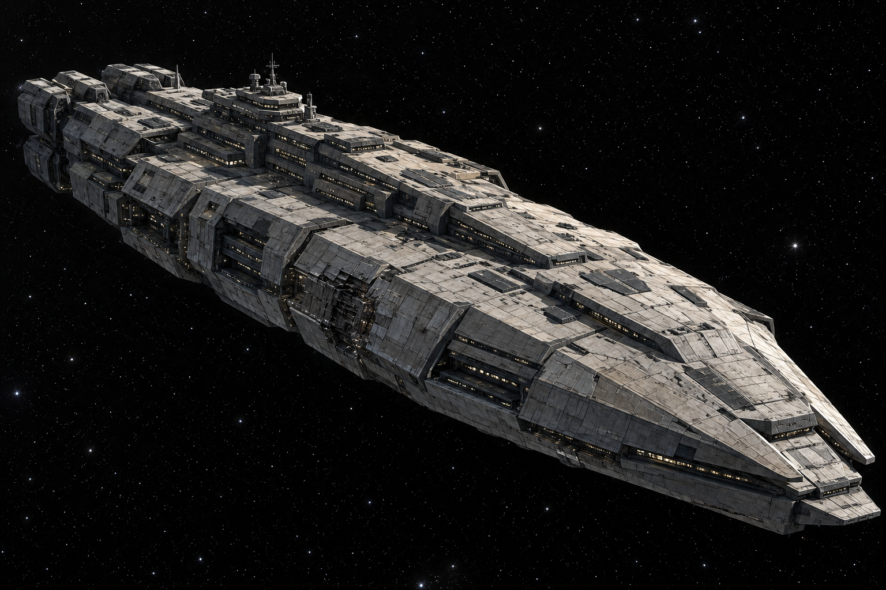

# Whole-ship atlas and exterior direction

The atlas is an out-of-world planning view. It places the built opening within a proposed ship envelope and sketches districts, routes, hazards and power distribution. It does not make those districts playable or establish exterior sensor knowledge for the character.

The accepted exterior direction is [exterior-concept-v2.png](exterior-concept-v2.png). It shows the pointed bow toward image right/lower foreground, the broad aft engine mass toward left/upper background and a raised bridge on the aft-midsection. The ship has been adrift about 1000 years. Story facts remain in [the design bible](../../design/biblia.md).



## Explore the atlas

From the repository root:

```sh
godot --path . docs/art/ship/3d/atlas.tscn
```

Use the deck selector for overview or D01 through D30. Port/core/starboard toggles filter the plan. Search facilities or districts, then select a result to focus it. Drag to orbit, Shift-drag to pan and use the wheel to zoom. R resets, brackets change decks, 0 returns to overview and D focuses the D14 opening. Route and power overlays have separate checkboxes.

Green marks built facilities, blue proposed facilities and red proposed radiation regions. Markers enlarge in overview; bounds and floor datums remain at metre scale. Districts are index bins for possible functions rather than measured room counts or complete hull occupancy.

## Sources and outputs

- `3d/ship_atlas.json`: proposed hull envelope, districts, facilities, routes and power graph.
- `3d/atlas.tscn` and `3d/atlas.gd`: interactive presentation.
- `3d/built-layout.json`: exported runtime opening placements.
- `build-map-board.py`: produces [ship-map-board.png](ship-map-board.png).
- `build-simple-guide.py`: produces [ship-overview-simple.png](ship-overview-simple.png) and [ship-start-simple.png](ship-start-simple.png).
- `sim/ship_layout.gd`: source of playable geometry and anchors, outside the planning atlas.

Ship axes are -X bow, +X stern, -Z port, +Z starboard and +Y up. The proposed envelope is 2400 by 720 by 192 m with 30 decks at 5.5 m pitch. D14 is Y=0. Those hull dimensions are unapproved planning values; a three-quarter exterior image does not supply orthographic measurements.

The built opening includes the D14 bay, hall and secondary-power room. Connectors and ladder wells extend the playable route, with the quarters on D16. The [runtime layout guide](../../dev/ship-layout.md) describes those spaces and door policies. The atlas's opening inset does not describe every currently traversable route.

## Planning content

The atlas groups command/navigation, civic/medical, escape muster, life support, workshops, generation and propulsion across the decks. Crew normally live awake, with cabins near their work areas. The design bible does not fix crew count, berth capacity or hull dimensions.

The plan has seven built opening pods and two proposed remote pods on D22. The distant room's purpose and allocation are unsettled. The irradiated armory is a story location; its proposed placement in R2 and the separate aft R1 region have no settled radiation cause. Their labels do not define M-drive physics or infer damage from hull scars.

Primary generation and distribution are separate. The atlas proposes primary generation near aft engineering, followed by isolation and distribution. The built D14 secondary generator is local backup. In-fiction deck knowledge arrives through repairs; exterior sensors remain unavailable early in the story.

For exterior changes, retain a plated, broad-aft silhouette with intact keel, drive machinery and main pressure shell. Keep outer damage localized to one outboard section and neighboring sealed compartments. Exposed exterior plating ages through impacts, sunlight and thermal fading. Interior metal can oxidize in the oxygenated atmosphere. Use directional sunlight and deep shadow against space without atmospheric fog.

## Rebuild and verify

Use a Python environment with Pillow, and run from the repository root:

```sh
godot --headless --path . -s tools/export_ship_layout.gd
python docs/art/ship/build-map-board.py
python docs/art/ship/build-simple-guide.py
godot --headless --path . -s docs/art/ship/3d/validate_atlas.gd
```

The export updates built records from the runtime layout. The builders write their PNGs beside the scripts and run image/layout assertions. The validator checks atlas structure and consistency without opening its scene. Runtime geometry tests are separate; run `godot --headless --path . -s tests/run_tests.gd` for those.

## Known limitations

The envelope, district allocations, remote pods, radiation causes and proposed routes remain design proposals. No crew capacity follows from the bin count. The hull cage is compatible with the exterior direction but is not a photogrammetric reconstruction. Earlier SVG atlases and exterior v1 files remain in the tree as source material; their dimensions and route assumptions are superseded and should not guide current implementation.
