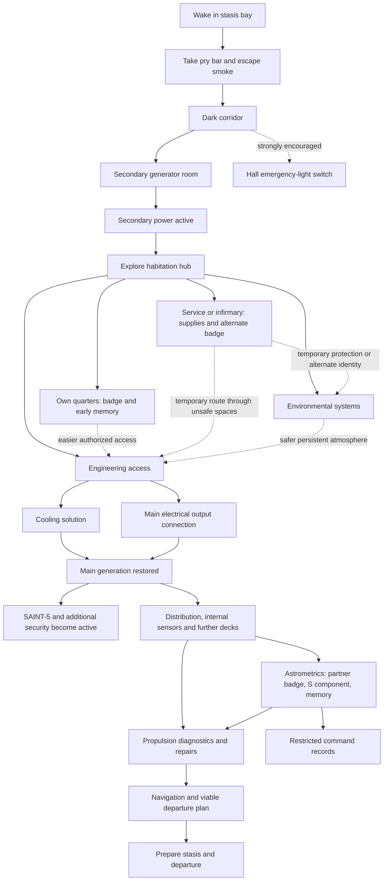

# GONE: Puzzle Progression

> **Status:** Design proposal, version **v0.1**, prepared **2026-11-01**. It describes candidate progression, not an approved implementation specification. The Spanish [design bible](biblia.md) wins on story facts and reveal protections. Open choices belong in [docs/design/decisions.md](decisions.md).

## 1. Purpose and non-negotiable principles

Design the ship as an interconnected environment where the player survives by exploring, diagnosing, repairing, improvising and using system behavior. Avoid a sequence of one-solution escape rooms or a guided objective-marker tour. (Source: `tmp/lore-intake/GONE_puzzle_progression_agent_handoff.md` §§0, 1.)

**Handoff engineering direction:** Keep simulation deterministic and testable headless, with tests independent of visual rendering. Keep rendering separate from simulation state, following the repository's `sim/` and `app/` separation. Extend the existing headless simulation tests and harness lanes rather than building a parallel harness. This direction applies to engineering work across the proposed systems, not just atmosphere tests, and does not claim these tests already exist or pass. (Source: handoff §§9, 11-12.)

The design principles are:

- Hard prerequisites are rare. Gate physical reality such as power, pressure, clearance, cooling and mechanical access, not a scripted quest order.
- Give material obstacles several intelligible engineering solutions where practical, such as credentials, physical bypass, restored mechanisms, permanent air repair or temporary protection.
- Let repairs change light, air, routes and threats, and let later evidence change the meaning of earlier places.
- Avoid arbitrary item combinations. Solutions should follow from ship systems.
- Preserve technical competence despite autobiographical amnesia.
- Keep play non-combat-focused. Tools, concealment, route planning and redirection take precedence over fighting; SAINT-5 is not a boss to destroy.
- Do not force exposition or make optional logs and memories universal movement gates.
- Use contextual interactions. Selected tools or credentials act automatically at compatible panels and readers; no verb menus.
- Let poor choices cost time, oxygen, power, safety or repair work while preserving credible recovery paths from reachable nonterminal states.

These principles guide the proposal. They do not assert that the systems are implemented. (Source: handoff §0; reconciliation §§1.14-1.15, 4.7.)

## 2. First-hour experience

The opening sequence is intentionally direct: wake in the smoky stasis room, take the fallen metal pry bar, force the jammed hatch, reach the dark corridor, use the nearby emergency-light switch if found, and activate the secondary generator. The corridor light is a steady red circuit in the current build; blinking belongs to the automatic fire circuit. The intended hazardous smoke escape is not yet a finished lethal timer. (Sources: handoff §§0, 5; `tmp/lore-intake/gone_story_summary.md` §4; `tmp/lore-intake/reconciliation.md` §§1.14, 5; baseline code verified in `app/hallway.gd`, `sim/smoke_symptoms.gd`, `tests/hallway_test.gd`.)

After secondary power, the design opens into overlapping goals: learn the protagonist's identity and find his quarters, improve air safety, and work toward main power. The cabin route is a proposal that permits early exploration before main power; the story summary's reveal sequence is emotional guidance, not a mandatory movement order. No cabin visit or story pickup should gate life support. (Sources: handoff §§0, 4, 8; reconciliation §§1.15, 2.18, 3.10, 3.12.)

The handoff's approximate first-hour pacing is a playtest hypothesis, not a scripted timer. Its intended progression is: focused escape, optional emergency lighting, secondary power, several hub destinations in flexible order, personal discovery, then survival and engineering tradeoffs leading toward main generation. (Source: handoff §4; reconciliation §4.7.)

## 3. First hub geography

The proposal reuses the existing straight corridor and six closed side-door leaves at x=9, 15 and 21, with one door on each side at each station. Room assignments and new passages are tentative. A proposed arrangement is a service locker and infirmary near x≈9, quarters and commons near x≈15, environmental control and engineering access near x≈21. No proposed room is established playable geography. (Sources: handoff §2; reconciliation §§1.15, 4.7.)

**Existing geometry rule:** Leaving stasis along +X, the hall switch is beside the stasis hatch at approximately (x=6.2, z=+0.85), on the right of that doorway. The secondary power-room entrance is the last door on the left at x=27, on the -Z wall. The power room lies beyond the side wall, not through the corridor's x-endcap. The +X-facing direction maps left to -Z and right to +Z. Comments in `app/game.gd` and `app/power_room.gd` still call the power-room door right; those comments are wrong and require a separate code change. (Sources: decisions brief §17; verified in `app/hallway.gd` constants `POWER_DOOR_X`, `SWITCH_PLATE_CENTER`, `tests/power_room_test.gd`, `tests/hallway_test.gd`.)

**Proposal:** Add service connections behind rooms to create loops and shortcuts with physical purposes, such as cable or air runs. Exact positions and access states require design. A structural schematic may show room names and intended connections without reporting pressure, damage, safety or bot position unless telemetry supports those facts. (Source: handoff §2; reconciliation §§1.15, 4.7.)

## 4. Dependency graph

This is a proposed logical dependency graph, not a required visit order. Solid arrows denote proposed dependencies. Dotted arrows denote aids or alternatives. Optional story evidence does not create a movement gate. (Sources: handoff §3; reconciliation §§1.15, 3.10, 3.12, 4.7.)

The opening route and secondary-power-to-hub connection are the proposed intended path. Whether a skilled player can explore the first hub in darkness remains open. Quarters, service, environmental systems and engineering are parallel branches. A badge, portable protection and repaired atmosphere are aids or routes, not universal prerequisites. Main generation must not require SAINT-5, which wakes when main power returns. (Sources: handoff §3; reconciliation §§1.15, 4.7.)

The astrometrics path is a useful route to the partner's badge, the missing S-drive component and later command access. The component may be discovered before the player understands its function. Do not require watching a memory or reading a log to progress. Whether the component is mandatory or can be replaced at substantial cost remains open. (Sources: handoff §§3, 5, 8; reconciliation §§1.13, 1.15, 3.12.)

## 5. Puzzle catalogue

All entries below are proposals and alternatives, not approved implementations. Their state should follow shared power, atmosphere, door and telemetry models rather than unrelated room-specific flags. (Sources: handoff §5; reconciliation §§1.15, 4.7.)

| ID | Obstacle | Candidate alternatives or limitation |
|---|---|---|
| P00 | Smoky stasis-bay exit | Initially one focused solution: take the fallen pry bar and force the hatch. |
| P01 | Dark corridor | Activate the emergency switch; alternatively, careful dark travel or a portable light if supported. Do not require the hall-light flag for every door. |
| P02 | Secondary generation | Use the working console and retain the current two-stage interaction as an opening candidate. |
| P03 | Own quarters | Use a manual release or suitable tool, or restore the local lock circuit. The badge inside cannot be required to enter. |
| P04 | Habitation atmosphere | Reroute available power to surviving circulation/scrubbing, repair or replace local equipment, or use temporary portable air. |
| P05 | Engineering access | Use the protagonist's badge, a maintenance/service path or a repaired mechanism. The reader route may expose his identity to security. |
| P06 | Generator cooling | Repair the primary cooling loop, or isolate damage and use reduced-capacity auxiliary cooling. |
| P07 | Main electrical output | Rebuild the distribution connection or install a lower-capacity temporary bypass. |
| P08 | SAINT-5 encounter | Avoid its current route, use doors and cues, or create a small maintenance fault to redirect its priorities. |
| P09 | Identity-sensitive security | Use a lower-clearance corpse badge, find a physical route or selectively isolate a device where credible. |
| P10 | Restricted command | Use the partner's badge, or investigate accessible perimeter/log routes so the captain's story does not depend on one credential. |
| P11 | Missing S-drive component | Diagnose its absence and follow evidence to astrometrics, or find the component first and understand it later. |
| P12 | Navigation and propulsion | Repair S-drive and conventional integration; alternative subsystem priorities may produce a slower or less reliable viable plan. |

Do not make each access problem another keycard lock. Reuse credentials, mechanisms and physical bypasses as systems with different consequences. Exact alternatives, including portable light, air, cooling and electrical bypasses, remain candidates. (Sources: handoff §§5, 13; reconciliation §§1.15, 4.7.)

## 6. Badges and security model

The protagonist's badge, found in or near his quarters, supplies his name, identity and useful permissions. Some security systems respond aggressively to that identity. A dead crew member's badge supplies less access without the same identity-specific response; its location and timing are open. The lover's badge in astrometrics offers higher access, including command and the captain's quarters. (Sources: story summary §§10-12; reconciliation §§1.12, 3.11.)

**Established interaction rule:** The player selects the active carried credential as equipment state; using a reader presents it contextually and automatically, with no verb menu. The robot recognizes bodies, not cards. (Sources: decisions brief §9; story summary §§10-11.)

**Proposal:** Keep access privilege distinct from identity-based security response. Exact clearance levels, hostile devices and fair escape routes remain open. (Sources: handoff §6; reconciliation §§1.11-1.12, 2.17, 2.22, 3.13.)

## 7. SAINT-5: antagonist and tool

Main power visibly activates SAINT-5. Its first useful behavior is to return to the stasis bay, extinguish the electrical fire and repair wiring. It is an industrial maintenance machine, not a comic character or conventional combatant. (Sources: story summary §6; reconciliation §§1.11, 3.14.)

SAINT-5 prioritizes repairs and is not a perpetual pursuer. If it finds the conscious protagonist, it may use lethal force under its containment instructions; if it finds him unconscious, it may return him to stasis. The exact arbitration between attacks, containment and urgent repairs remains open. (Sources: story summary §§6, 8; reconciliation §§1.11, 2.17, 4.7.)

Established direction: the player can cooperate indirectly with SAINT-5, which performs useful repairs and can undo deliberate disconnections; maintenance faults can manipulate its priorities. (Sources: story summary §§6-7; decisions brief §9; docs/design/biblia.md §§35-36.)

**Proposal:** Limit repeated distractions so they cannot create an infinite stun-lock. Initially the player relies on sound, repair traces and learned routes. Restored telemetry can reveal its position only in monitored areas. (Sources: handoff §§7, 13G; reconciliation §1.11.)

## 8. Story integration without forced order

The puzzle route should support story discovery without enforcing it. Rooms, objects, logs, systems and memories carry evidence; the player is not assigned a quest list. The crew's ordinary lives and conflicting views should appear through a mix of human details and incomplete evidence, not a convenient explanatory log in every room. (Sources: story summary §§2, 13; bible Part IV §§39-41; reconciliation §§1.13-1.14.)

The proposed early cabin visit offers a badge, personal effects, a photograph and a damaged video message. The room may appear pristine in a memory without announcing a flashback. The message says the lover is waiting in astrometrics with a surprise; it does not disclose pregnancy. Finding or watching it must not be required for life support or movement. (Sources: story summary §§9, 38; handoff §8; reconciliation §§1.13, 2.18, 3.10.)

Astrometrics can bring together the partner's badge, the missing S-drive component and a later memory. The player can find the component before understanding why it matters. The badge pickup memory shows her body and the protagonist's “No!” without establishing the cause of death. The updated story direction says she died accidentally while he tried to restrain her, and he remains responsible; exact staging must follow the bible and decisions ledger. Do not use a puzzle to settle choreography. (Sources: story summary §§11, 26, 38; decisions brief §1; reconciliation §§1.8, 1.13, 3.16.)

The reveal order is emotional guidance, not an enforced movement sequence. Evidence should converge, and optional logs or memories should not gate movement. The final fate of Earth, the century's records, and the ending remain within the limits set by the bible and decisions ledger. (Sources: story summary §§30-33, 38; reconciliation §§1.10, 3.12, 4.8.)

## 9. Power, atmosphere and doors

Keep generation capacity, distribution, loads, compartment atmosphere, door state and player knowledge separate. Early secondary power is limited. Proposed loads include ventilation, CO₂ scrubbers, circulation, lighting, cooling, computers, doors, security and sensors. Conditions should evolve over time, and power restoration should not imply that every area is immediately breathable or repaired. (Sources: handoff §9; story summary §§4-5; reconciliation §1.14.)

**Proposal:** Offer an early tradeoff between sustained environmental support and a more convenient engineering route, with temporary protective air or manual access as alternatives. This tradeoff's strength and form are undecided. Doors can independently depend on mechanical condition, power, authorization and pressure. Numerical atmosphere, power and cooling thresholds remain open. (Sources: handoff §§9, 13C; reconciliation §§1.14, 2.23, 4.7.)

## 10. Avoiding hard and soft locks

Before adding an obstacle, test whether the player could arrive without the expected item, credential or power allocation; whether retreat and recovery are possible; whether a component can be found before its explanatory log; whether doors or power cycling can trap the player; and how SAINT-5 changes the route. Prefer reusable system knowledge over one-off trigger guessing. (Source: handoff §10.)

**Proposed invariant:** Every reachable nonterminal state should retain a credible route to continued progress, potentially through retreat, load reallocation, waiting for a repair or conditional stasis. Hard mode can still permit death and irreversible consequences. Avoid arbitrary state combinations that make an unsaved run impossible solely because the player explored in a different order. (Sources: handoff §10; reconciliation §§1.14, 4.7.)

## 11. Proposed staged delivery

The following slices are proposed engineering milestones, not claims of existing features. (Sources: handoff §11; reconciliation §4.7.)

### Slice A: Structural hub and navigation

Reuse the corridor and door positions. Greybox proposed functional entrances and service loops, add signage or a local structural directory, and permit at least two hub destinations in different orders. Test collision, wayfinding and return paths while preserving the opening and generator regression tests.

### Slice B: Quarters and first badge

Build the protagonist's cabin with ordinary personal details. Provide two credible entry methods that do not require its badge, or one automatic physical fallback if the powered route fails. Add contextual badge selection and diegetic identity/permission information. Add a memory hook without revealing the sabotage, and keep progression possible if the cabin is skipped. (Source: puzzle handoff §11, Slice B.)

### Slice C: Atmosphere and load allocation

Model 2-3 actual controllable loads and at least two compartments with different environment states. Implement both a service/scrubber repair option and a temporary portable-air option. Show delayed environmental changes and recovery after reallocation. Reconcile stasis-bay ventilation with issue #71 before treating it as implemented; add deterministic tests for depletion, recovery and poor allocations. (Source: puzzle handoff §11, Slice C.)

### Slice D: Engineering and main power

Provide candidate authorized and manual access routes. Treat cooling and output distribution as separate requirements with alternatives. Main power should wake systems without repairing the entire ship. A return to the stasis bay can show a physical improvement. The pre-activation solution must not depend on SAINT-5.

### Slice E: SAINT-5 and security prototype

Prototype maintenance job selection, movement through connected rooms, physical player recognition, audible cues and escapable encounters. Distinguish identity-sensitive ship security from bot recognition. Test a repair diversion and a blocked route that remain solvable without combat. Later sensor restoration should use the same bot position state.

Astrometrics, command, drives and departure are later proposed slices, after first-deck systems prove reusable. Do not make her death a mechanical puzzle without an explicit story decision. (Source: handoff §11.)

## 12. Acceptance scenarios

These are proposed tests and playtest scenarios, not completed verification. Cover the opening, multiple exploration orders, gradual atmosphere changes, recovery from poor load choices, contrasting badge behavior, main-power activation, repair diversion, out-of-order evidence and recovery from route changes. Walk the level without quest markers to assess whether a first-time player can infer the next actions from cues. (Sources: handoff §12; reconciliation §4.7.)

1. **Opening route:** stasis, pry bar, forced hatch, corridor lighting and secondary power, preserving current staging.
2. **Hub route A:** secondary power, quarters, protagonist's badge, engineering by reader.
3. **Hub route B:** secondary power, service supplies or temporary air, engineering by service path without quarters.
4. **Atmosphere allocation:** power a scrubber, observe gradual improvement, remove it, observe deterioration, then reallocate and recover.
5. **Bad-choice recovery:** allocate power poorly, retreat, change priorities and continue.
6. **Credential consequence:** the protagonist's badge opens an appropriate door and triggers a specified hostile response; the other badge avoids that identity response but lacks a permission elsewhere.
7. **Main-power reveal:** restore cooling and distribution, activate main generation, then show SAINT-5 doing maintenance before its threat is encountered.
8. **Maintenance diversion:** a serviceable fault redirects SAINT-5; it resumes normal priorities rather than freezing.
9. **Out-of-order discovery:** find a component or log before its context; later evidence explains it without broken flags or repeated scenes.
10. **No route softlock:** repeated toggles, closed doors, power cycling and skipped optional locations retain a credible recovery path.

## 13. Decisions to surface

A. “Which exact existing side door maps to which planned room?” Preserve corridor coordinates and update signage/voice consistently.

B. “Is secondary power a true mandatory first-hub gate, or can a skilled player explore in darkness using a portable source?”

C. “How severe should the first power tradeoff be: mutually exclusive sustained loads, or merely inefficient simultaneous loads with brownouts?”

D. “How strongly should a character recognize his own quarters before obtaining the badge?” Avoid heavy inner monologue.

E. “Which early security device first exposes the badge danger, and what fair escape does that scene offer?”

F. “Is the alternate crew badge in an infirmary, isolated room, or a later compartment?” Give its presence a convincing reason.

G. “What are the precise rules governing when the maintenance robot attacks, returns an unconscious protagonist to stasis, or chooses an urgent repair?”

H. The accepted account is accidental death while he restrains her, with responsibility retained, per `docs/design/decisions.md`. The remaining open question is exact gun choreography.

I. The approximate five-year S+H and thirty-Earth-year S+conventional estimates are settled per `docs/design/decisions.md`. Exact dates and distances, and whether the S component can be substituted at substantial cost, remain open.

(Source: `tmp/lore-intake/GONE_puzzle_progression_agent_handoff.md` §13; wording follows the reconciled question list in `tmp/lore-intake/reconciliation.md` §4.6.)

## Appendix: Baseline at 450234f

This appendix records the local repository baseline at commit `450234f6fbfab904349604c4fef8adb857a15ccc`, as reported by reconciliation §5 and checked against its cited files here. It is a static inspection, not a test run. No claims are made about remote branches, current issue status or features outside the inspected files. (Source: `tmp/lore-intake/reconciliation.md` §5.)

### Opening and corridor

The stasis bay has seven pods, a wake sequence, a fallen metal rod, a jammed exit, sparks and smoke presentation. `app/hallway.gd` defines the straight corridor and six closed side doors at x=9, 15 and 21. `tests/hallway_test.gd` checks the six closed doors and the corridor geometry. The corridor has no smoke subtree. (Sources: `app/hallway.gd`; `tests/hallway_test.gd`; reconciliation §5.)

The power-room doorway is at x=27 on the north, -Z wall. The hall switch's z coordinate is +0.85. `tests/power_room_test.gd` pins the power-door leaf at (27, 1.1, -1.47); `tests/hallway_test.gd` pins the switch at z=+0.85. Thus, when walking out of stasis along +X, the room door is on the left and the switch is on the right. Comments in `app/game.gd` and `app/power_room.gd` still say right about the power-room entrance and are incorrect. This documentation records the mismatch; correcting code comments is a separate change. (Sources: decisions brief §17; reconciliation §5; verified files above.)

`app/power_room.gd` places the room beyond that side entrance, with its footprint centered at x=27 and extending from x=21 to x=33. It is not a doorway in the corridor's far endcap. (Sources: `app/power_room.gd`; `tests/power_room_test.gd`; reconciliation §5.)

### Secondary power and lighting

`app/game.gd` stores `door_open`, `hallway_lit`, `power_door_open`, `console_state` and `power_active`. The power room door opens without a rod gate. Its single working console uses a two-step state transition: the first interaction displays “Inactivo,” the second activates secondary power. `tests/power_room_test.gd` checks those behaviors and the two-room route. (Sources: `app/game.gd`; `app/power_room.gd`; `tests/power_room_test.gd`; reconciliation §5.)

`app/lighting.gd` implements the stasis bay's red emergency fixtures. The hallway and generator room have red emergency lighting plus dim regular white lighting. Secondary-power activation hands the hallway and power room to white while the stasis bay remains red. The stasis bay is excluded from the current secondary-power lighting transition. This does not demonstrate ventilation or a general life-support effect. (Sources: `app/lighting.gd`; `app/hallway.gd`; `app/power_room.gd`; `tests/power_room_test.gd`; reconciliation §5.)

### Simulated power and smoke

`sim/power.gd` has only `EMERGENCY` and `DEAD` states for the stasis-bay emergency circuit, with a cut-only transition. `Game.power_active` separately drives the secondary-power visual state; it does not add general distribution or atmosphere simulation. (Sources: `sim/power.gd`; `app/game.gd`; reconciliation §5.)

`sim/smoke_symptoms.gd` computes position-based, reversible exposure and produces audio/visual symptoms. It does not implement death or an opening timer, and its exposure does not depend on secondary-generator activation. `app/hallway.gd` and its test confirm the hallway has no smoke. This build therefore does not fulfill the proposed fatal smoke deadline or the requested issue #71 behavior of secondary-power ventilation stopping bay exposure while sparks remain. (Sources: `sim/smoke_symptoms.gd`; `app/hallway.gd`; `tests/hallway_test.gd`; reconciliation §5.)

### Proposed systems absent from the inspected implementation

The inspected `app/` and `sim/` files implement the stasis bay, hallway and secondary power room. They do not implement the proposed quarters, infirmary, environmental room, engineering route, hub loops, badges, identity-sensitive security, SAINT-5 behavior, internal sensor map, later decks or general atmosphere/load model. The A-E slices and acceptance scenarios above remain proposals. (Sources: `app/game.gd`, `app/hallway.gd`, `app/power_room.gd`, `sim/power.gd`, `sim/smoke_symptoms.gd`, `tests/power_room_test.gd`, `tests/hallway_test.gd`; reconciliation §5.)

This baseline records existing code and test assertions; it does not claim those tests were run or passed during this documentation task.
