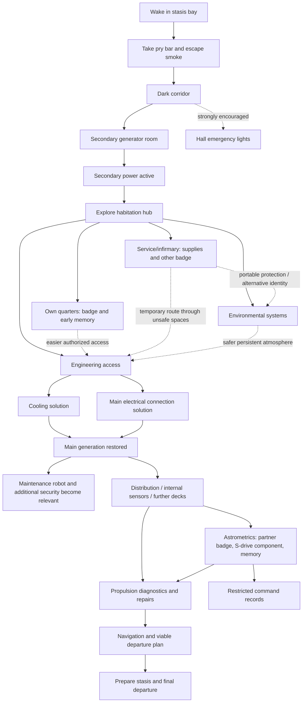

# GONE — Puzzle, Navigation, and Progression Design

**Agent handoff / design draft v0.1**  
**Prepared:** 2026-11-01  
**Repository:** https://github.com/acoliver/gone  
**Suggested eventual repo location:** `docs/design/puzzle-progression.md`  
**Status:** Design proposal, **not** an approved implementation specification in every detail.

## 0. Purpose and priorities

Design the ship as an interconnected, partially simulated environment in which the player survives by exploring, diagnosing, repairing, improvising, and exploiting the behavior of the ship's systems. The game is **not** a sequence of one-solution escape rooms or a guided objective-marker tour.

The player starts with three relatively direct opening actions:

1. Wake in a smoke-filled stasis room, take the fallen metal pry bar/crowbar, and force the door before smoke incapacitates or kills him.
2. Reach the dark hall and activate its emergency lighting.
3. Reach the secondary generator room and restore limited secondary power.

After that, the design should open into overlapping goals and several possible orders of play. Early exploration should naturally draw the protagonist toward **his own quarters**, where he finds **his security badge**, name, role, personal effects, and early evidence of his relationship. The badge is useful but has a hidden disadvantage: some ship-security systems are specifically hostile to his identity.

### Non-negotiable design principles

- **Hard prerequisites are rare.** Gate physical reality (power, pressure, clearances, cooling, mechanical access), not a scripted quest order.
- **Several solutions to material obstacles.** E.g., access via credentials, physical bypass, or restoring a mechanism; environmental safety via permanent repair or temporary protective equipment.
- **Revisit locations with changed meaning.** Repairs change light, air, available routes, and threats. Earlier story evidence gains significance later.
- **No arbitrary adventure-game item combinations.** Solutions must be intelligible consequences of ship engineering.
- **Competence without autobiographical memory.** The player character knows procedures and can recognize technical systems, even though he cannot remember his history.
- **No weapon-centric gameplay.** Tools and systems, concealment, route planning, and redirection matter more than combat. The repair bot is not a boss to destroy.
- **No forced exposition.** Logs and memories are mostly environmental and optional; the main story should be reconstructed from converging evidence rather than single required lore pickups.
- **Contextual interactions.** If a suitable badge or tool is selected/carried, using a relevant reader or panel applies it; no verb-menu busywork.
- **Meaningful consequences, not softlocks.** Bad choices cost time, oxygen, power, safety, or repairs, but leave credible recovery options.

## 1. Repository baseline — verify at current HEAD before coding

The following reflects inspection of `main` during the preceding design discussion (2026-10-28). **Do not assume it is still current.** Begin by inspecting the latest GitHub HEAD, relevant branches/PRs, implementation, tests, and issues.

Relevant files:

- `README.md`
- `docs/design/biblia.md` — older Spanish narrative/design bible; contains both enduring design pillars and story details that may now conflict with newer decisions.
- `docs/design/story.md` — opening wake staging, defers to bible at the time it was written.
- `docs/design/concept.md` — original game pillars; contains obsolete dog/combat milestone ideas; not authoritative when superseded.
- `app/hallway.gd`, `app/power_room.gd`, `app/game.gd`, `app/motion.gd`, `app/player.gd`
- `sim/power.gd`, `sim/smoke_symptoms.gd`, `tests/power_room_test.gd`
- GitHub issue #71 — secondary power should ventilate the stasis bay, restore its normal lighting, stop smoke exposure while retaining sparking wires.
- GitHub issue #74 — voice-line draft has a possible left/right discrepancy; verify against actual level geometry rather than repeating the line blindly.

### Known playable scope at that inspection

- Seven-pod stasis bay with wake sequence, fallen **metal rod/pry bar**, jammed exit door, sparks and smoke.
- Straight corridor, emergency-light switch, and six closed side doors at three stations (`x = 9, 15, 21`, two sides per station).
- Secondary-power-room entrance at the far end (`x = 27`), opening on an ungated interaction; its generator can be activated with the existing working console (first interaction shows **Inactivo**, second makes it **Activo**).
- Restoring secondary power transitions hallway and generator-room red emergency lights to dim normal lights.
- Existing `Game` state includes `door_open`, `hallway_lit`, `power_door_open`, `console_state`, and `power_active`.
- **Important gap:** current smoke symptoms were reversible exposure/audio/vision effects, not a finished death/timer system. Do not falsely claim the opening timed-death design is already implemented.
- **Important gap:** the existing simulated `Power.Grid` had only emergency/dead states for stasis-bay emergency fixtures; a general load/distribution/atmosphere model is not already present merely because secondary-power visuals exist.
- Crew quarters, environmental room, infirmary, engineering access, expanded deck loops, security-badge logic, bot pursuit, and later decks were **proposed**, not implemented.

Preserve the tested opening geometry and controls unless there is a compelling reason to change them. In particular, **do not silently flip the existing power room's actual side** to match a narrative line or diagram. The assignments below are conceptual until mapped onto the live level.

## 2. Geography: first exploration hub

Expand the current corridor into a compact **habitation-deck hub**. The six existing side-door openings are the natural basis for six early locations. Add one or more service connections behind rooms so the layout is a graph with loops, not a long string of dead ends.

Suggested functional assignments (exact left/right positions are **tentative** and must be reconciled with real world coordinates and signage):

| Corridor station | Side A | Side B | Why it exists |
|---|---|---|---|
| Near, x≈9 | Service locker | Infirmary | Tools, portable atmosphere supply, early alternate identity |
| Middle, x≈15 | Crew quarters / protagonist's cabin | Commons / other crew rooms | First personal discovery and human backstory |
| Far, x≈21 | Environmental control | Engineering access | Competing power needs; route to main generation |
| End, x≈27 | Secondary generator room, already authored | — | Earliest restoration of limited power |

**Secondary passages:** one narrow maintenance connection between accommodation and service/infirmary, and one utility passage linking environmental controls toward engineering. These should have a physical purpose (cable/air runs, service hatches), not feel like arbitrary secret tunnels. Some are initially inaccessible or unsafe; reopening them creates shortcuts and alternate threat-avoidance paths.

**Map information:** let the player eventually see structural deck schematics even without functioning sensors. The schematic knows room names and intended connections, but not current pressure, damage, robot positions, or safety until corresponding telemetry exists. No permanent GPS-like quest markers.

## 3. The dependency graph (logical requirements, not mandatory visit order)

**Solid arrows** are proposed meaningful dependencies. **Dotted arrows** are aids or alternatives, **not hard gates**. Engineering access can be obtained through high credentials, a maintenance path, or other physical work. Do not make finding the protagonist's badge necessary for entering his own quarters.

`Main generation restored` **must not depend on robot assistance** if that event is what reactivates the robot. The bot's useful repair behavior becomes a resource in later stages.

## 4. Intended player experience, approximately first hour

Time ranges are pacing hypotheses to playtest, not scripted timers.

| Rough phase | Player-facing situation | What becomes possible | Mandatory? |
|---|---|---|---|
| Immediate opening | Smoke, blocked door, one obvious pry bar | Escape | Yes, intentionally linear tutorial |
| First dark corridor | Cannot see much; emergency-light control is nearby | Illuminate hall | Strongly encouraged; darkness need not be an invisible hard flag |
| Secondary-power room | One functioning control console, room of dead terminals | Limited lighting/power and local ventilation | Yes for the intended first hub |
| Hub exploration | Several visible doors and systems, some hazardous or restricted | Explore quarters, locker, infirmary, commons, environmental, engineering in different orders | No fixed visit order |
| Personal discovery | Cabin feels familiar; badge and photograph/terminal | Identity, authorized access, early relationship clue | Strong incentive; not a universal progression lock |
| Survival/engineering | Limited power and unreliable atmosphere force tradeoffs | Persistent air, temporary protection, generator access | Multiple solutions |
| Main-generation restoration | Ship wakes, first visible maintenance-bot repairs | More energy, more routes, new danger | Major transition |

### How the player finds his cabin without being led by the nose

The player must **infer or notice** the cabin, not receive a glowing objective marker. Plausible cues:

- Crew-section signs and a partial directory become readable after secondary power.
- The cabin door/unit or items in the vicinity provoke an understated recognition without providing a waypoint.
- Nearby lockers/crew records reveal his identity in ways that can be cross-referenced to the cabin.
- The floor plan can show cabin numbers without magically telling him which is his.

The cabin entrance must have a solution independent of possessing the badge inside it: an emergency mechanical release, restored local circuit, or equivalent. At least one reasonably discoverable route must be available on arrival.

## 5. Puzzle catalogue and alternatives

The choices below are **design candidates**. Build them around a coherent power/atmosphere/door model; do not simply implement disjointed hard-coded booleans for every room.

| ID | Obstacle / destination | Option A | Option B (or more) | Consequences / payoff |
|---|---|---|---|---|
| P00 | Escape smoky stasis bay | Take fallen pry bar and force jammed hatch | No alternate initially: a deliberately focused opening | Smoke exposure is urgent; opening establishes physical tool interaction |
| P01 | Navigate dark corridor | Activate emergency switch by stasis hatch | Navigate carefully in darkness or with an available portable light, if later supported | Visibility vs. risk; do not gate every doorway on `hallway_lit` |
| P02 | Activate limited secondary generation | Use working control console | Keep currently implemented two-stage console sequence initially | Restores hub lighting and selected services; does not magically heal whole ship |
| P03 | Enter own quarters | Manually release/force door with suitable tool | Restore crew-zone circuit or power lock actuator | Badge must not be required to retrieve itself |
| P04 | Make habitation atmosphere usable | Reroute limited electricity to surviving circulation/scrubber | Repair/replace faulty local scrubber; portable-air approach temporarily avoids repair | Different safety, time and power costs |
| P05 | Reach engineering | Present protagonist badge at compatible reader | Use maintenance passage / service hatch; repair door mechanism | Fast/authorized route may expose identity to security; manual route risks air/power problems |
| P06 | Restore generator cooling | Repair damaged primary coolant loop | Isolate damage and run auxiliary cooling at reduced capacity | Affects output, heat, system availability; no impossible zero-solution state |
| P07 | Connect main electrical output | Rebuild damaged distribution connection | Install lower-capacity temporary bypass | Primary power comes online but load capacity/distribution remains constrained |
| P08 | Handle repair robot after awakening | Stay out of route; close doors; use sound cues | Create a small electrical maintenance fault / call to redirect its repair priority | Robot remains necessary and generally too robust to destroy |
| P09 | Bypass identity-sensitive security | Carry lower-clearance badge from dead crew member | Find a physical route or selectively isolate a security device where possible | Safe credentials may fail restricted access; own badge higher access but higher risk |
| P10 | Enter/operate restricted Command | Recover partner's badge in astrometrics | Explore physically accessible Command perimeter or investigate via independent logs; decide which systems truly require partner credentials | Not every piece of captain's story must be behind a single card gate |
| P11 | Recover missing S-drive component | Diagnose absence through propulsion system; follow evidence to astrometrics | Discover hidden component by exploratory search first | Same component, different discovery order; player may possess it before understanding its significance |
| P12 | Restore usable navigation/propulsion | Repair conventional propulsion and S-drive integration | Alternate subsystem repair priorities that produce a slower/less reliable viable plan | Final journey possible with degraded performance; no late-game shooter/combat turn |

**Do not design six identical “find keycard, open door” puzzles.** Badges change privilege, identity and risk; physical bypass and electrical restoration should be reused as *systems* with locally different consequences.

## 6. Badge and security model

Badges are especially important because the ship's security is not merely randomly broken. It has a historical reason for treating the protagonist as hostile. The player should recognize this only gradually.

| Badge | Where found | Uses | Costs / implications |
|---|---|---|---|
| **Protagonist's** | Own quarters, early | Name, role, high access to many doors and consoles | Some security devices flag/attack him on authentication |
| **Dead crew member's** | A plausible corpse in infirmary or isolated compartment | Low-privilege doors; generally does not trigger protagonist-specific authentication response | More limited privileges; may require slower alternate route for restricted tasks |
| **Partner's** | Astrometrics, later | Certain Command doors/records and a crucial personal story connection | Picking it up triggers a brief memory of her body and his cry of “No!” (subject to latest narrative canon and staging decisions) |

The player should be able to explicitly select which carried badge to present, without making each interaction a menu. A selected/active credential on a restrained toolbelt is sufficient. Security must not be uniformly lethal on every reader or the badge's apparent benefit disappears too early.

**Two distinct threat systems:**

- **Ship security:** credential-sensitive cameras, terminals, locks, or turrets (exact devices TBD). Authentication and historic containment/traitor flags matter. Changing badge can change the response.
- **Maintenance robot:** physically encounters and recognizes the conscious protagonist; prioritizes ship repairs and can be redirected by maintenance needs. Merely changing a badge should **not** trivialize the robot.

A fair encounter has readable audio/visual cues, a plausible escape, and consistent detection rules.

## 7. Maintenance robot: systemic antagonist and tool

The original narrative bible specifies:

- On return of main generation, the bot becomes active.
- Its first noticeable action is **useful**: it extinguishes the stasis-bay electrical fire and repairs damaged wiring. Revisiting the initial room provides a visual payoff.
- It is industrial, heavy, and extremely difficult for a person to damage; it has manipulators/tools, not conventional military weapons.
- Its chief task is **maintenance**. If it encounters the conscious protagonist, it tries to neutralize him, but it does not chase forever at the expense of urgent repairs.
- Small electrical faults and maintenance requests can distract or redirect it. It should respond particularly quickly to electrical faults.
- Internal sensors are initially down, so the player must listen, track its repairs, learn paths and create distractions. Restored internal telemetry later changes tactics by showing its location.
- In appropriate situations the bot may return an unconscious protagonist to stasis rather than killing him outright. Narrative time-skips/stasis recovery need careful separate design and must not be mistaken for ordinary lives/respawns.

Create a **priority-based job model**, not a fixed scripted chase per room. Include a contention/priority rule so intentional player-created defects can redirect it without making an infinite free stun-lock. Its helpful repairs may undo player-created bypasses or deliberate power cuts.

## 8. Story integration without forced order

Keep the main survival and repair flow independent of whether the player has inspected every memory or log.

### Own quarters: early emotional anchor

The room provides a badge, photograph, ordinary possessions, and the damaged video message from his partner. In the earlier staging, she jokes that she is waiting in **astrometrics** to surprise him; that initially reads as affection. Later it explains why she discovered him. The present room and its remembered pristine version contrast sharply; avoid an explicit “FLASHBACK” UI.

The player may encounter this early, late, or potentially in an alternate order with other clues. Avoid conditioning life-support repair on watching the video.

### Astrometrics: three intersecting motivations

- The partner's badge and associated memory.
- A hidden critical **S-drive** component removed by the protagonist during the sabotage.
- Records or physical evidence which, much later, allow the player to understand the confrontation.

He sabotaged the **H-drive** during the outward journey; the S-drive is still potentially usable with conventional propulsion, at far lower effective speed. A player can find the component before understanding what it is. Later propulsion diagnostics can retroactively explain its relevance.

### Later revelations: reconcile canon first

Recent Naleya/Nalesha story work supersedes parts of `docs/design/biblia.md`:

- The protagonist was from **Earth (Tewa)** and served with a crew from another civilization.
- His partner was the **captain's daughter** and was pregnant; details of their relationship matter enormously to later revelations.
- The captain initially refused an order to exterminate Earth's people. After his daughter's death, the captain carried out the order and placed the protagonist in stasis.
- More than a century has passed. Records describe devastating destruction on Earth, but do **not** prove absolutely that every human died.
- The only reachable refuge is the crew's civilization's world. The damaged vessel can attempt a journey of about 30 Earth years using viable S-drive/conventional propulsion; a working S+H arrangement would have been far faster.
- The ending remains unresolved: the protagonist enters stasis again; neither arrival nor acceptance is confirmed.

**Critical unresolved conflict:** the older repo bible frames the protagonist's action leading to his partner's death as deliberate and morally attributable; the newer synopsis describes an accidental death while trying to restrain her. **Do not settle this conflict implicitly while authoring puzzles or flashbacks.** Treat newer approved story material as the candidate canon, surface a concise decision for the author, and do not make an early puzzle reveal the precise circumstances regardless.

Another important detail from the updated story: the ship's written language does **not** physically switch to Spanish; the protagonist experiences an interpretation/recognition phenomenon. Do not build a world-state mechanic that actually rewrites every sign without authorization.

## 9. Power and atmosphere design constraints

A good early tradeoff: limited secondary generation can initially supply **either** robust environmental services in habitation **or** a more convenient powered route into engineering, without satisfying all loads at once. The player can compensate with time-limited portable atmosphere supplies and manual access.

Separate these concerns in the underlying state:

1. **Generation capacity:** available watts/abstract units; emergency, secondary, and main systems.
2. **Distribution connectivity:** breakers, buses, damaged connections, and local power availability. Restoring generation does not fix broken distribution.
3. **Loads and priorities:** ventilation, CO₂ scrubbers, door actuation, security, sensors, lighting, cooling, computers.
4. **Atmosphere by compartment:** O₂, CO₂, pressure, smoke, temperature; hazardous conditions evolve over time, not instant toggles.
5. **Door condition:** physical jam, electrical actuator availability, permission, pressure interlock, manual release.
6. **Knowledge / telemetry:** which measurements are trustworthy or even accessible to the player.

**Do not conflate** the existing secondary-power lighting transition with every life-support system suddenly becoming normal. Issue #71's requested **stasis-bay** ventilation on secondary power can coexist with other compartments still needing power/scrubber repairs.

Use deterministic headless simulation with tests independent of visual rendering, matching the repository's separation between `sim/` and `app/`.

## 10. Avoiding hard and soft locks

Before creating a puzzle, answer:

- Can a player arrive here without the expected item or credentials?
- Is there an intelligible alternate route, recovery strategy, or safe retreat?
- What happens if they already spent the relevant power capacity elsewhere?
- What happens if they find an important component before encountering the log that describes it?
- Can they enter an unsafe compartment but fail to leave due to a door/circuit they just disconnected?
- How does the robot's presence change this solution without randomly invalidating progress?
- Is the player learning a *system* they can reuse, or guessing a unique scripted trigger?

Suggested invariant: for every **reachable nonterminal game state**, some credible path to continued progress exists (even if it requires retreat, changing load allocation, waiting for a bot repair, or temporary stasis, depending on difficulty mode). A hard mode can allow death/irreversible consequences, but should not silently create impossible save states because of arbitrary quest ordering.

## 11. Proposed staged delivery for the engineering agent

The priority is one testable, replayable **hub vertical slice**, not the entire rest of the game at once. Before making broad scene changes, inspect current HEAD and write a concise milestone breakdown for review.

### Slice A — Structural hub and navigation

- Reuse current corridor geometry and door placements.
- Greybox six functional side-room entrances and 1–2 connected service routes.
- Add non-magical signage / local structural directory.
- Make at least two hub destinations accessible in differing orders.
- Test collision, door logic, wayfinding, and return paths.
- Preserve the opening and generator harness regression lanes.

### Slice B — Protagonist's quarters and first badge

- Build the cabin with ordinary personal details.
- Two credible means to enter without already holding its badge, or one automatic physical fallback if the powered route fails.
- Acquire/select/present the badge contextually.
- Expose name, role and permissions in a diegetic way.
- Add initial photograph/message/memory *hook* without spoiling the later sabotage.
- Ensure game progression is possible if the cabin has not been visited.

### Slice C — Limited atmosphere / load-allocation puzzle

- Model 2–3 actual controllable loads and at least two compartments with different environment states.
- Implement a service/scrubber repair option and a temporary portable-air option.
- Make electricity allocation visibly affect conditions with delayed transitions.
- Ensure the stasis-bay secondary-power ventilation behavior is reconciled with #71.
- Add deterministic simulation tests for depletion/recovery and recovery from poor allocation.

### Slice D — Engineering access and main-power restoration

- Offer an authorized path and a manual/service path.
- Model cooling and output-distribution as separate requirements, each with alternative solutions.
- Restoring main power wakes additional systems **but does not automatically repair the entire ship**.
- Return to the stasis bay should demonstrate some visible physical improvement.
- Add no bot dependency to the pre-bot power-start solution.

### Slice E — Bot/security systemic prototype

- Basic maintenance job selection and movement between graph-connected rooms.
- Player recognition/attack with audio cues, patrol/repair priorities and escapable encounters.
- Distinct identity-sensitive security prototype and contrasting lower-level badge.
- One repair-triggered diversion and one path blocked by the bot, both solvable without combat.
- Later sensor restoration can be designed using the same underlying bot position state.

### Later slices — Astrometrics / Command / Drives / Departure

Design with the updated narrative canon and only implement after the first-deck systems prove reusable. Do not build narrative scene triggers or make her death a mechanical puzzle without an explicit story decision.

## 12. Tests and acceptance scenarios

Agent should extend existing headless simulation tests and harness lanes. Recommended behavioral scenarios:

1. **Canonical opening:** stasis -> pry bar -> force hatch -> corridor lights -> secondary power, with current staging intact.
2. **Nonlinear hub route A:** secondary power -> own quarters -> own badge -> engineering via reader.
3. **Nonlinear hub route B:** secondary power -> service locker / temporary air -> engineering via service passage **without visiting quarters**.
4. **Atmospheric allocation:** allocate limited power to scrubber -> environment improves gradually; remove it -> CO₂/O₂ changes over time; reallocate -> recovery is possible.
5. **Bad-choice recovery:** player powers the wrong load, retreats, switches priorities, still progresses.
6. **Credential consequence:** own badge grants a door yet triggers hostile security on a specific reader; other crew badge does not trigger that identity response but lacks permissions somewhere else.
7. **Main power reveal:** main generation comes online only after viable cooling/distribution state; maintenance bot repairs something and then presents a threat.
8. **Maintenance diversion:** a fault request draws bot away from one route; it resumes normal repair goals afterward rather than freezing.
9. **Out-of-order discovery:** recover a component or log early, then later diagnostics/memories contextualize it; no broken flags or repeated cinematics.
10. **No route softlock:** repeated toggles, doors closing, power cycling and optional location skips retain at least one viable recovery path.

Acceptance is not just test-green. Walk the level without quest markers and assess whether visual/sound cues genuinely let a first-time player infer actions. Testing must include different exploration orders.

## 13. Decisions to surface, not assume

A. Which exact existing side door maps to which planned room? Preserve actual corridor coordinates, then update signage/voice cues consistently.  
B. Is secondary power a true mandatory first-hub gate, or can a skilled player explore in darkness using a portable source? The latter can be allowed without compromising the intended first path.  
C. How severe should the first power tradeoff be: mutually exclusive sustained loads, or merely inefficient simultaneous loads with brownouts?  
D. How strongly should a character recognize his own quarters before obtaining the badge? Avoid heavy inner-monologue guidance.  
E. Which early security device first exposes the badge danger, and what fair escape does that scene offer?  
F. Is the alternate crew badge in an infirmary, isolated room, or a later compartment? It needs a convincing reason to be there.  
G. What are the precise rules governing when the maintenance robot attacks, returns an unconscious protagonist to stasis, or chooses an urgent repair?  
H. Resolve the older/newer partner-death narrative conflict before authoring the later flashbacks.  
I. Confirm the latest S/H-drive travel timing and whether the missing S-drive component is mandatory for departure or can be substituted at substantial cost.

## 14. Immediate next action for the receiving agent

**First, inspect the current `acoliver/gone` HEAD and report:** (1) what already exists versus the baseline above, (2) the exact six side-door locations/geometry and any conflicting dialogue, (3) a proposed room-to-door assignment, (4) concrete Slice A/B implementation tasks and tests, and (5) any conflicts with the newest story canon. **Do not silently implement the entire game plan or resolve story ambiguities as engineering decisions.**

The core success criterion is simple: after escaping and restoring secondary power, a first-time player can choose meaningfully between **finding out who he is, making the ship safer to breathe, and working toward main power**, without the game directing him through a fixed sequence.
